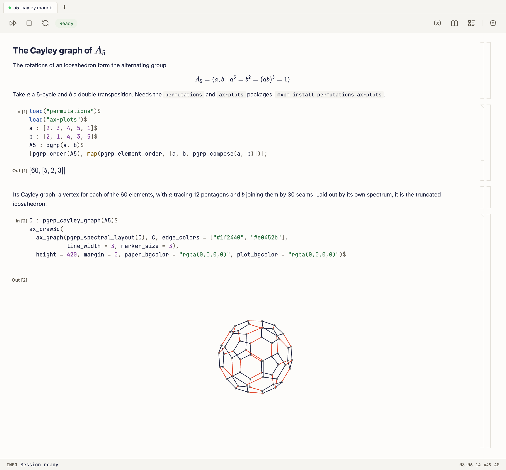

# Aximar

A modern, cross-platform desktop GUI and tooling suite for the [Maxima](https://maxima.sourceforge.io/) computer algebra system. Aximar provides a notebook-style interface with beautifully rendered math output via KaTeX, plus an LSP server, a DAP debugger, and an MCP server for AI integration.

The GUI is built with [Tauri v2](https://tauri.app/) (Rust backend) and React + TypeScript (frontend). The shared `aximar-core` library powers all components — GUI, MCP server, and debugger.



The notebook in the screenshot is [assets/a5-cayley.macnb](assets/a5-cayley.macnb); it needs the `permutations` and `ax-plots` packages (`mxpm install permutations ax-plots`). See the [vector calculus example](assets/vc.pdf) for a Stokes' theorem verification notebook.

## Features

- **Notebook interface** — code and Markdown cells, drawn as cards or with brackets in the margin; a cell shows when it's running (In [\*]) or waiting in a Run All (In [·])
- **LaTeX math rendering** — Maxima output rendered with KaTeX
- **Interactive plots** — Plotly.js charts via `ax_draw2d`, `ax_draw3d`, `ax_plot2d`, and `ax_polar`, with pan, zoom, and hover. Includes contour plots, heatmaps, bar charts, histograms, vector fields, and phase portraits
- **Classic plots** — Maxima's built-in `plot2d` and `plot3d` rendered as inline SVGs; point at any plot to save it as SVG, PNG or JSON
- **Function discovery** — searchable catalog of 2500+ functions, docs panel, hover tooltips
- **Command palette** — every command, function and symbol (Ctrl+K / Cmd+K)
- **Smart editor** — syntax highlighting, autocomplete, signature hints
- **Find & replace** — search across cells with regex support
- **Explained errors and notes** — an explanation for each error Maxima gives, with "did you mean?" suggestions and correct signatures; notes on what Maxima printed (`rat: replaced 0.5 by 1/2`) in place of its raw lines, with Maxima's own text a click away
- **Next steps** — the + between cells offers a code cell, a Markdown cell, or a next step for the result above, such as Simplify, Integrate or Plot; a setting turns these off for a class
- **Languages** — Maxima's own messages in the language you choose, help in Spanish, German, Japanese or Portuguese once its documentation pack is installed (`mxpm install maxima-core-docs-es`), and the window and menus ready for translators (see [docs/i18n.md](docs/i18n.md))
- **Variables panel** — inspect and manage bound variables
- **Templates** — starter notebooks for calculus, linear algebra, plotting, and more
- **Light, paper, dark or auto theme** — follows your system preference or set manually; paper is warm off-white with ink text
- **MCP server** — AI integration via Model Context Protocol, with built-in setup for Claude Code, Codex, and Gemini CLI
- **Multiple backends** — run Maxima locally, in Docker/Podman, or via WSL
- **Save & load** — persist notebooks in Jupyter-compatible format; drag `.macnb` or `.ipynb` files onto the window to open them, or open them from Finder (double-click, Open With, or a drop on the Dock icon)
- **Print support** — configurable margins and font sizes for printing

## Supported Platforms

Each [release](https://github.com/cmsd2/aximar/releases) has packages for:

| Platform | Architectures | Packages | Minimum version |
|----------|---------------|----------|-----------------|
| macOS | Apple silicon, Intel | `.dmg` | macOS 11 (Apple silicon), 10.13 (Intel) |
| Windows | x64, ARM64 | `.msi`, `-setup.exe` | Windows 10 |
| Linux | x86_64 | `.deb`, `.rpm`, `.AppImage` | glibc 2.39 and WebKitGTK 4.1, as in Ubuntu 24.04, Debian 13 and Fedora 40 |
| Linux | arm64 | `.deb` | as for x86_64 |

Aximar draws its window with the system web view: WebKit on macOS and
Linux, WebView2 on Windows. Windows 11 includes WebView2, and the
installers download it on Windows 10 if it's missing. Windows 7 and 8
are not supported.

The Linux packages are built on Ubuntu 24.04 and need the glibc it
ships, so they don't run on older distributions. There, [build from
source](#building-from-source).

## Getting Started

### Installing Maxima

Aximar requires a working [Maxima](https://maxima.sourceforge.io/) installation.

| Platform | Install |
|----------|---------|
| macOS (Homebrew) | `brew install maxima` |
| Ubuntu/Debian | `sudo apt install maxima` |
| Fedora | `sudo dnf install maxima` |
| Windows | See [Windows setup](#windows-setup) below |

### Windows Setup

On Windows you have three options for running Maxima:

**Option 1: Native Windows install (Local backend)**

Download and install Maxima from [sourceforge.net/projects/maxima](https://sourceforge.net/projects/maxima/). Aximar will automatically detect installations at `C:\maxima-*\bin\maxima.bat`. You can also set a custom path in Settings.

**Option 2: WSL backend**

If you use [Windows Subsystem for Linux](https://learn.microsoft.com/en-us/windows/wsl/install), you can run Maxima inside a WSL distribution:

1. Install Maxima in your WSL distro (e.g. `sudo apt install maxima`)
2. In Aximar, open Settings and set the backend to **WSL**
3. Select your distro from the dropdown — Aximar will show whether Maxima was found

Plotting works automatically — Aximar copies rendered SVGs from the WSL filesystem to a local temp directory.

**Option 3: Docker/Podman backend**

Run Maxima in a container for full isolation:

1. Install [Docker Desktop](https://www.docker.com/products/docker-desktop/) or [Podman](https://podman.io/)
2. Pull a Maxima image (e.g. `docker pull maxima/maxima`)
3. In Aximar, set the backend to **Docker**, choose your engine, and enter the image name

### Maxima detection order

Aximar looks for the `maxima` binary in these locations (local backend):

1. `AXIMAR_MAXIMA_PATH` environment variable
2. `/opt/homebrew/bin/maxima`, `/usr/local/bin/maxima`, `/usr/bin/maxima`
3. Windows: `C:\maxima-*\bin\maxima.bat`
4. Falls back to `maxima` on `PATH`

## Using the App

### Cells

- **Type a Maxima expression** in a cell (e.g. `integrate(x^2, x);`)
- **Shift+Enter** runs the cell and moves to the next one; on the last cell it puts the caret below, where typing starts a new cell
- **Ctrl/Cmd+Enter** runs the cell and stays in it
- **Insert a cell** by clicking the gap between two cells and typing (`#` starts a Markdown cell), or from the Cell menu. The gap's + opens a menu: a code cell, a Markdown cell, or a next step for the result above, which adds a cell and runs it. Tab at the caret opens the same menu
- **Run All**, **Interrupt** and **Restart** are on the toolbar and in the Cell and Session menus; Restart clears Maxima's state, not your cells
- **Right-click a cell** for its commands: run, insert, move and delete

### Keyboard shortcuts

Every command is in the menu bar with its shortcut, and Help > Keyboard
Shortcuts lists them all. Hold Ctrl (or Cmd on Mac) to see the common ones.

| macOS | Windows and Linux | Command |
|-------|-------------------|---------|
| ⌘N | Ctrl+N | New notebook (in a new tab) |
| ⇧⌘N | Ctrl+Shift+N | New window |
| ⌘O | Ctrl+O | Open |
| ⌘S / ⇧⌘S | Ctrl+S / Ctrl+Shift+S | Save / Save as |
| ⇧⌘E | Ctrl+Shift+E | Export as LaTeX |
| ⌘P | Ctrl+P | Print |
| ⌘W | Ctrl+W | Close tab (the window, on its last tab) |
| ⇧⌘W | Ctrl+Shift+W | Close window |
| ⌘Z / ⇧⌘Z | Ctrl+Z / Ctrl+Shift+Z | Undo / redo the notebook's last change |
| ⌘F / ⇧⌘F | Ctrl+F / Ctrl+Shift+F | Find / find and replace |
| ⇧↩ | Shift+Enter | Run the cell and move on |
| ⌘↩ | Ctrl+Enter | Run the cell and stay |
| ⇧⌘↑ / ⇧⌘↓ | Ctrl+Shift+Up / Down | Move the cell |
| ⇧⌘⌫ | Ctrl+Shift+Backspace | Delete the cell |
| ⌘. | Ctrl+. | Interrupt |
| ⌘K | Ctrl+K | Command palette: commands, functions and symbols |
| ⇧⌘] / ⇧⌘[ | Ctrl+Shift+] / [ | Next / previous tab (also Ctrl+Tab, Ctrl+Shift+Tab) |
| ⌘/ | Ctrl+/ | Keyboard shortcuts |
| ⌘, | Ctrl+, | Settings |
| ↑ / ↓ | Up / Down | From a cell's first or last line, to the gap beside it, then the next cell |
| ⇥ | Tab | At the caret between cells, the + menu: a code or Markdown cell, or a next step |
| \\ | \\ | Symbol entry in the palette: type a LaTeX name (e.g. `\alpha`, `\leq`, `\nabla`) to insert Unicode |

### Settings

Open Settings from the toolbar, or with Cmd+, (Ctrl+, on Windows and Linux). A sidebar lists its sections, and each setting has a one-line hint under it. Changes apply at once. Settings reopens at the section you used last.

- **General**: language, help language, theme, whether the variable panel opens at start, and the open-source licences
- **Notebook**: font size, cell style, argument help, suggested next steps, Markdown font and indent
- **Maxima**: backend (Local, Docker or WSL) and its fields, the evaluation timeout, and a line saying which Maxima Aximar runs and where it found it
- **Printing**: print font size and margins (mm)
- **AI assistants**: the MCP server, whether it is listening, and setup for Claude Code, Codex and Gemini CLI (see [Connected mode](#connected-mode-recommended)); the address and token sit under Advanced
- **Translation**: in pre-release builds only, tools for translators (see [docs/i18n.md](docs/i18n.md))

The Maxima Not Found dialog has an Open Settings button that goes to the Maxima section, and a log entry about the MCP server failing to start links to AI assistants.

### Logging

The status bar at the bottom of the app shows the most recent event. Click it to open the log window with two tabs:

- **App Log** — session events, evaluation results, warnings, and errors
- **Maxima Output** — raw stdin/stdout/stderr from the Maxima process (useful for debugging)

### Example expressions

```
integrate(x^2, x);
diff(sin(x)*cos(x), x);
solve(x^2 - 5*x + 6 = 0, x);
expand((a + b)^4);
factor(x^4 - 1);
taylor(exp(x), x, 0, 5);
```

### Plotting

Aximar provides its own `ax_*` plotting functions that render as interactive Plotly.js charts with pan, zoom, and hover. These are auto-loaded — no `load(...)` needed.

```
/* Interactive 2D plot */
ax_plot2d(sin(x), [x, -%pi, %pi])$

/* Multiple curves with styling */
ax_draw2d(
  color="red", explicit(sin(x), x, -%pi, %pi),
  color="blue", explicit(cos(x), x, -%pi, %pi),
  title="Trig Functions"
)$

/* 3D surface */
ax_draw3d(explicit(sin(x)*cos(y), x, -%pi, %pi, y, -%pi, %pi))$

/* Polar plot */
ax_polar(1 + cos(θ), [θ, 0, 2*%pi])$

/* Contour plot */
ax_draw2d(ax_contour(sin(x)*cos(y), x, -%pi, %pi, y, -%pi, %pi), colorscale="Viridis")$

/* Bar chart */
ax_draw2d(ax_bar(["Q1","Q2","Q3","Q4"], [100,150,120,180]), title="Sales")$

/* Vector field with phase portrait */
ax_draw2d(
  color="#cccccc", ax_vector_field(-y, x, x, -3, 3, y, -3, 3),
  color="red", ax_streamline(-y, x, x, -3, 3, y, -3, 3),
  aspect_ratio=true, title="Phase Portrait"
)$
```

Maxima's built-in `plot2d` and `plot3d` are also supported and render as inline SVGs.

## MCP Server (AI Integration)

Aximar exposes its capabilities via the [Model Context Protocol](https://modelcontextprotocol.io/), letting AI assistants search function docs, manage notebook cells, run Maxima expressions, and inspect session state. There are 30 tools — see `docs/mcp-server.md` for the full list. Explanations and notes in results mark code with backticks, as Markdown does.

### Connected mode (recommended)

When the Aximar app is running, enable the MCP server in Settings. It listens on `localhost:19542` with bearer token authentication.

**One-click setup**: the AI assistants section of Settings has **Configure** buttons for [Claude Code](https://docs.anthropic.com/en/docs/claude-code), [Codex](https://github.com/openai/codex) and Gemini CLI that register the MCP server with the correct URL and auth token. Opening Settings runs none of these programs: Aximar looks for them on PATH and reads Codex's and Gemini CLI's configuration files. Claude Code's status needs its CLI, so press **Check** to see it.

You can also configure manually:

```bash
# Claude Code
claude mcp add --transport http \
  --header "Authorization: Bearer <token>" \
  -- aximar http://localhost:19542/mcp

# Codex — add to ~/.codex/config.toml:
# [mcp_servers.aximar]
# url = "http://localhost:19542/mcp"
# http_headers = { "Authorization" = "Bearer <token>" }
```

### Headless mode

The standalone `aximar-mcp` binary runs its own Maxima session over stdio, without the GUI.

```bash
# Build it
cargo build -p aximar-mcp --release

# Register with Claude Code
claude mcp add aximar -- ./target/release/aximar-mcp
```

Verify either mode is working:

```bash
claude mcp list
```

## Building from Source

### Prerequisites

- [Node.js](https://nodejs.org/) >= 18
- [Rust](https://rustup.rs/) (stable toolchain)
- Tauri v2 system dependencies — see the [Tauri prerequisites guide](https://tauri.app/start/prerequisites/) (Fedora users: see [`docs/building-on-fedora.md`](docs/building-on-fedora.md))

### Development

```bash
npm install --dev
npm run tauri dev
```

This starts both the Vite dev server (frontend hot-reload) and the Tauri Rust backend.

### Release build

```bash
npm run tauri build
```

The bundles go to `target/release/bundle/` at the repository root, one
folder per package type:
- macOS: `.app` bundle and `.dmg`
- Linux: `.deb`, `.rpm` and `.AppImage`
- Windows: `.msi` installer and NSIS `-setup.exe` installer

To build one type, name it with `--bundles`, for example
`npm run tauri build -- --bundles app` for the macOS `.app` alone.

### Running tests

```bash
# Rust unit tests (all workspace crates)
cargo test --workspace

# TypeScript type checking
npx tsc --noEmit
```

## IDE Support

The repository also includes tools for working with Maxima `.mac` files in VS Code and other editors.

### maxima-lsp

A [Language Server Protocol](https://microsoft.github.io/language-server-protocol/) server for Maxima. Provides go-to-definition, document symbols, diagnostics, and hover documentation for `.mac` files. See `docs/maxima-lsp.md` for details.

```bash
cargo build --release -p maxima-lsp
```

### maxima-dap

A [Debug Adapter Protocol](https://microsoft.github.io/debug-adapter-protocol/) server for Maxima. Provides interactive debugging of `.mac` files in VS Code — breakpoints, stepping, call stack, and variable inspection. Requires Maxima with the SBCL backend. See `docs/maxima-dap.md` for details.

```bash
cargo build --release -p maxima-dap
```

Both work with the [Maxima Notebook extension for VS Code](https://github.com/cmsd2/maxima-notebook), a fork of the [original extension](https://github.com/yshl/maxima-extension) by Ohta Yasuhiro with added LSP and DAP support.

## Architecture

The app communicates with Maxima through a long-lived subprocess. The Rust backend manages this process, sending expressions via stdin and reading results from stdout using a sentinel-based protocol. See `docs/maxima-protocol.md` for details.

```
React Frontend  <->  Tauri IPC  <->  Rust Backend  <->  Maxima subprocess
                                                         (stdin/stdout)
```

| Layer | Technology |
|-------|-----------|
| Desktop shell | Tauri v2 |
| Frontend | React 19, TypeScript, Vite |
| Code editor | CodeMirror 6 |
| Interactive plots | Plotly.js |
| Math rendering | KaTeX |
| State management | Zustand |
| Subprocess I/O | tokio::process |

## Alternatives

- **[wxMaxima](https://wxmaxima-developers.github.io/wxmaxima/)** — the long-established GUI for Maxima, built with wxWidgets. wxMaxima offers a mature feature set including interactive animations with slider controls, `table_form()` for tabular data display, and notebook export to HTML/LaTeX. Aximar aims to provide a more modern interface and cross-platform experience via Tauri, but wxMaxima remains an excellent choice — especially if you need animation support or `.wxm`/`.wxmx` file compatibility.

## License

GPL-3.0-or-later

Aximar builds on open-source code and fonts, whose notices ship with the app: open them from Settings, General, Licences. The tools release archives carry the Rust crates' notices as `THIRD-PARTY-RUST.html`. See [docs/licences.md](docs/licences.md) for how they're made and which licences Aximar accepts.
